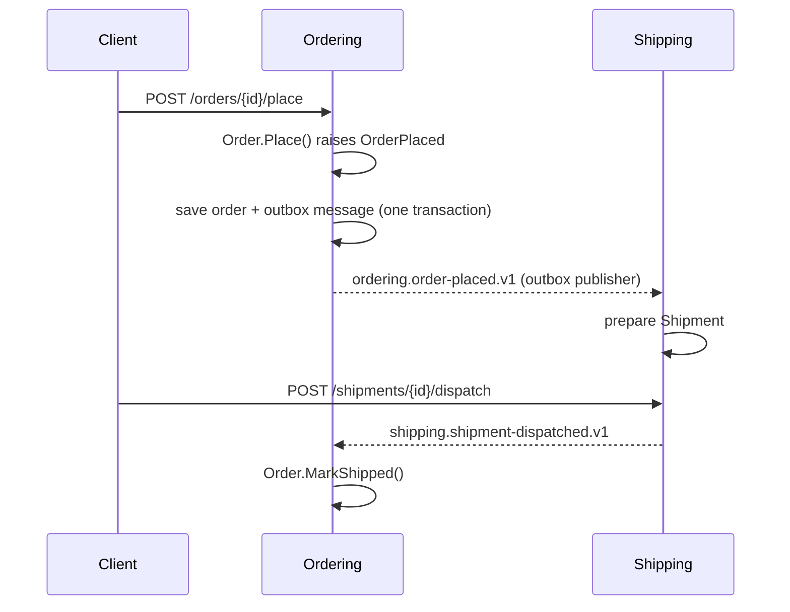

# Domain-Driven Design in .NET — a working playbook

A small, complete .NET solution that shows the tactical patterns of Domain-Driven Design working
together, with documentation that explains each one and how to apply it to your own solution.

It is deliberately not a framework. Every piece is short enough to read in one sitting, copy into
your codebase and own.

## What it shows

| Topic | Read | See it in code |
|---|---|---|
| Ubiquitous language | [docs/ubiquitous-language.md](docs/ubiquitous-language.md) | the names in [Order.cs](src/Ordering/Ordering.Domain/Orders/Order.cs) |
| Bounded contexts | [docs/bounded-contexts.md](docs/bounded-contexts.md) | [src/Ordering](src/Ordering) and [src/Shipping](src/Shipping) |
| Rich domain model | [docs/rich-domain-model.md](docs/rich-domain-model.md) | [Order.cs](src/Ordering/Ordering.Domain/Orders/Order.cs) |
| Entities and value objects | [docs/entities-and-value-objects.md](docs/entities-and-value-objects.md) | [OrderLine.cs](src/Ordering/Ordering.Domain/Orders/OrderLine.cs), [ValueObjects.cs](src/Ordering/Ordering.Domain/Orders/ValueObjects.cs) |
| Aggregates and aggregate roots | [docs/aggregates.md](docs/aggregates.md) | [AggregateRoot.cs](src/BuildingBlocks/BuildingBlocks.Domain/AggregateRoot.cs) |
| Invariants | [docs/invariants.md](docs/invariants.md) | [Invariant.cs](src/BuildingBlocks/BuildingBlocks.Domain/Invariant.cs), [Result.cs](src/BuildingBlocks/BuildingBlocks.Domain/Result.cs) |
| Domain events (`OrderPlaced`) | [docs/domain-events.md](docs/domain-events.md) | [DbContextBase.cs](src/BuildingBlocks/BuildingBlocks.Infrastructure/Persistence/DbContextBase.cs) |
| Outbox (and inbox) | [docs/outbox-pattern.md](docs/outbox-pattern.md) | [Outbox/](src/BuildingBlocks/BuildingBlocks.Infrastructure/Outbox) |
| Repository pattern | [docs/repositories.md](docs/repositories.md) | [OrderRepository.cs](src/Ordering/Ordering.Infrastructure/OrderRepository.cs) |
| Layer boundaries | [docs/layers.md](docs/layers.md) | [BoundaryTests.cs](tests/Architecture.Tests/BoundaryTests.cs) |
| Domain tests without a database or web server | [docs/domain-tests.md](docs/domain-tests.md) | [OrderTests.cs](tests/Ordering.Domain.Tests/OrderTests.cs) |

Then: [apply it to your own solution](docs/applying-to-your-solution.md), and read the
[pitfalls](docs/pitfalls.md) before you do.

## The sample

A shop with two bounded contexts that talk only through published integration events:



- **Ordering** owns orders: lines, prices, currency, the rules for placing and cancelling.
- **Shipping** owns shipments: what goes in the box, where it goes, when it left.

## Quick start

Requires the .NET 10 SDK.

```shell
dotnet test Shop.slnx
dotnet run --project src/Shop.Api
```

Then run the requests in [Shop.Api.http](src/Shop.Api/Shop.Api.http) top to bottom. See
[getting started](docs/getting-started.md) for a guided tour.

## Layout

```text
src/
  BuildingBlocks/          Reusable base: aggregate root, outbox, inbox, domain event dispatch
  Ordering/                One bounded context
    Ordering.Domain/         Aggregates, value objects, domain events, repository interface
    Ordering.Application/    Use cases, event handlers, read models
    Ordering.Infrastructure/ EF Core mapping, repository, module registration
    Ordering.Contracts/      The integration events other contexts may depend on
  Shipping/                Another bounded context, same shape
  Shop.Api/                Host: composes the contexts and exposes HTTP endpoints
tests/
  Ordering.Domain.Tests/   Pure domain tests: no database, no web server
  Shipping.Domain.Tests/
  BuildingBlocks.Infrastructure.Tests/  Outbox, inbox, versioning against real SQLite
  Architecture.Tests/      Layer and context boundaries
  Shop.Api.Tests/          End to end through HTTP
```

## License

[MIT](LICENSE)
