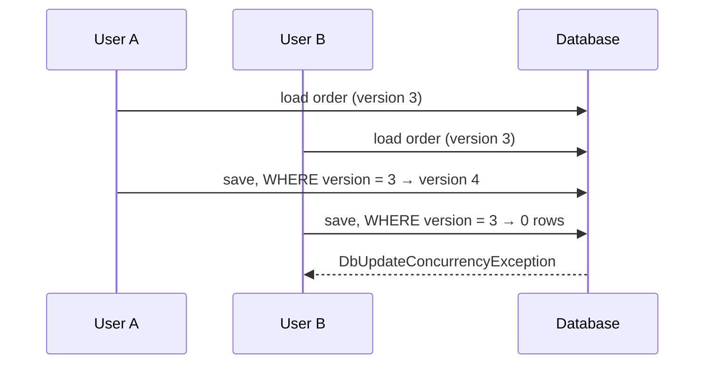

# Aggregates and aggregate roots

An aggregate is a cluster of objects that is changed as one unit, because together they must
satisfy rules. The aggregate root is the one entity in the cluster that the outside world talks to.

In the sample, `Order` is the root; its `OrderLine`s, their `Money` prices and the
`ShippingAddress` are inside. "An order has at most 20 lines, all in the order's currency" is a rule
about the whole cluster, so the whole cluster is one aggregate.

## The rules for handling aggregate roots

### 1. Only the root is reachable from outside

Code outside the aggregate holds a reference to the root, never to something inside. There is no
`OrderLineRepository`, and `OrderLine`'s mutating methods are `internal`:

```csharp
public sealed class OrderLine : Entity<OrderLineId>
{
    internal void IncreaseQuantity(Quantity extra) => Quantity = Quantity.Add(extra);
}
```

To change a line, you ask the order: `order.AddLine(...)`. Only then can the order check the rules
that involve all lines.

### 2. The root guards every invariant of the aggregate

After every public method returns, the whole aggregate is valid. Not "valid after the service also
calls `Recalculate()`" — valid. See [invariants.md](invariants.md).

### 3. Reference other aggregates by id

`Order` holds a `CustomerId`, not a `Customer`. Shipping's `Shipment` holds an `OrderReference`,
not an `Order`. Object references across aggregates invite one transaction to change two
aggregates and make loading unpredictable.

### 4. Change one aggregate per transaction

A use case loads one aggregate, calls one method, saves. When placing an order must also cause
something in another aggregate, the first one raises a [domain event](domain-events.md) and the
other reacts — in the same context through a domain event handler, across contexts through an
integration event and the [outbox](outbox-pattern.md).

This is why repositories in this sample have `SaveChangesAsync` and there is no separate unit of
work: one repository, one aggregate, one save. See [repositories.md](repositories.md).

### 5. Load and save the whole aggregate

A repository returns a complete aggregate, never half of one, so the root can always check its
rules. That is the main force that keeps aggregates small.

### 6. Protect against concurrent changes

Two users change the same order at once: without protection, the last save silently wins and may
break an invariant that each user's copy satisfied on its own.

Every aggregate root has a `Version`. [DbContextBase.cs](../src/BuildingBlocks/BuildingBlocks.Infrastructure/Persistence/DbContextBase.cs)
increments it on every save that changes anything inside the aggregate — also when only a line
changed — and uses it as a concurrency token. The losing save fails with
`DbUpdateConcurrencyException`; the caller reloads and retries, or reports a conflict.



The test `A_concurrent_change_is_refused_and_its_outbox_messages_are_not_stored` in
[SaveChangesTests.cs](../tests/BuildingBlocks.Infrastructure.Tests/SaveChangesTests.cs) shows it.

## Designing aggregate boundaries

Start from the invariants, not from the data model:

1. List the rules that must hold **immediately and always** ("total never exceeds the credit limit").
2. Group the data each rule needs. Each group is a candidate aggregate.
3. For every rule that spans groups, ask the business: *does this have to be true at every instant,
   or is it fine if it becomes true shortly after?* Almost always the latter — and then it is a
   process between aggregates, not a reason to merge them.

| Signal | Probably |
|---|---|
| Loading the aggregate pulls hundreds of rows | too big; split, or move a collection to its own aggregate |
| Many concurrency conflicts on the same root | too big; unrelated changes collide |
| A rule needs data from two aggregates every time | too small, or the rule is really a process |
| Use cases routinely change two aggregates together | boundary in the wrong place |

## The base class

[AggregateRoot.cs](../src/BuildingBlocks/BuildingBlocks.Domain/AggregateRoot.cs) adds two things to
an entity: the list of raised domain events and the `Version`. Both are infrastructure-agnostic; EF
Core concerns (ignoring the events, using the version as a concurrency token) are configured in
`DbContextBase`, so the domain stays clean.
