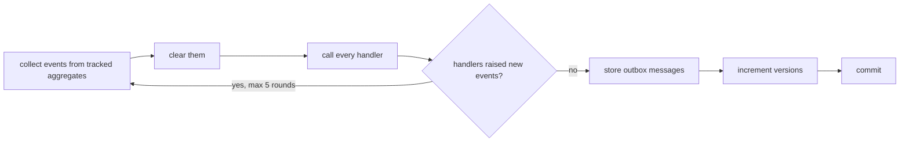

# Domain events

A domain event records something that happened in the domain that other parts of the system care
about. It is named in the past tense, in the [ubiquitous language](ubiquitous-language.md):
`OrderPlaced`, `OrderCancelled`, `ShipmentDispatched`.

## Domain events and integration events

The sample uses two kinds, on purpose.

| | Domain event | Integration event |
|---|---|---|
| Example | `OrderPlaced` | `OrderPlacedIntegrationEvent` (`ordering.order-placed.v1`) |
| Audience | the same bounded context | other bounded contexts |
| Types | rich: `OrderId`, `Money`, `ShippingAddress` | primitives and nested records only |
| Lives in | `Ordering.Domain` | `Ordering.Contracts` |
| Handled | in-process, inside the same transaction | after the commit, via the [outbox](outbox-pattern.md) |
| Can change freely? | yes, it is internal | no, it is a public contract: add a `v2` instead |

Keeping them separate lets the domain model evolve without breaking other contexts, and lets you
decide per event what to publish. `OrderCancelled` is published only when the order had been placed;
a cancelled draft is nobody else's business.

## How it is implemented

### 1. The aggregate raises the event

```csharp
public Result Place(ShippingAddress shippingAddress, DateTimeOffset now)
{
    // ... rules ...
    Status = OrderStatus.Placed;
    Raise(new OrderPlaced(Id, CustomerId, Total, lines, shippingAddress, now));
    return Result.Success();
}
```

`Raise` (in [AggregateRoot.cs](../src/BuildingBlocks/BuildingBlocks.Domain/AggregateRoot.cs)) only
adds the event to a list. The aggregate does not know who listens, and nothing happens yet.

### 2. Saving dispatches the events, before the commit

[DbContextBase.cs](../src/BuildingBlocks/BuildingBlocks.Infrastructure/Persistence/DbContextBase.cs)
overrides `SaveChangesAsync`:



Dispatching **before** the commit means every change a handler makes is part of the same
transaction: all of it is saved, or none of it. The round limit stops two handlers that trigger each
other from looping forever.

### 3. Handlers react

A handler implements `IDomainEventHandler<TEvent>`
([Handlers.cs](../src/BuildingBlocks/BuildingBlocks.Application/Handlers.cs)) and is registered by
assembly scanning. In the sample the handlers translate domain events into integration events:

```csharp
public sealed class PublishOrderPlaced(IOutbox outbox) : IDomainEventHandler<OrderPlaced>
{
    public Task Handle(OrderPlaced domainEvent, CancellationToken cancellationToken)
    {
        outbox.Enqueue(new OrderPlacedIntegrationEvent(...), messageGroup: $"order-{domainEvent.OrderId}");
        return Task.CompletedTask;
    }
}
```

Other typical handlers: update a read model, or change another aggregate **in the same context**
(load it through its repository and call a method; it is tracked by the same DbContext and saved in
the same transaction).

### 4. Other contexts react later

The integration event is published after the commit by the outbox. Shipping's
`PrepareShipmentWhenOrderPlaced` implements `IIntegrationEventHandler<OrderPlacedIntegrationEvent>`;
it runs in its own scope and its own transaction, deduplicated by the inbox.

## What to put in an event

- **What happened, and when.** `OccurredAt` comes from the time passed into the method.
- **Enough for the expected handlers**, so they do not have to query back. `OrderPlaced` carries the
  lines and the address.
- **Ids, not object references** to other aggregates.
- **Nothing that is not true yet.** Raise after the state change has been decided, never before a
  check that could still fail.

## Testing events

Events are plain data on the aggregate, so a domain test asserts them directly — no mocks, no
database:

```csharp
order.Place(Address, Now);

var placed = order.DomainEvents.OfType<OrderPlaced>().Single();
Assert.That(placed.Total, Is.EqualTo(Eur(25.00m)));
```

Dispatching itself is tested once, in
[SaveChangesTests.cs](../tests/BuildingBlocks.Infrastructure.Tests/SaveChangesTests.cs).

## Why no MediatR

Dispatching is about forty lines in
[DomainEventDispatcher.cs](../src/BuildingBlocks/BuildingBlocks.Infrastructure/DomainEvents/DomainEventDispatcher.cs).
A library is fine too; the important part is *when* events are dispatched (before the commit, in
the same transaction) and *what* crosses a context boundary (a contract, through the outbox).
