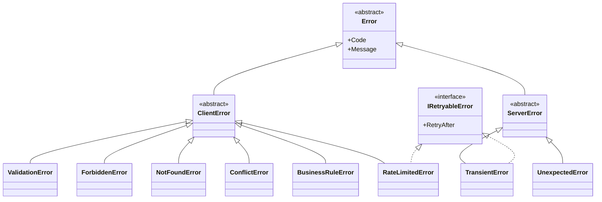

# Error handling with result types

Most failures in a business application are not bugs: the order is already shipped, the shipment
does not exist, the payment provider is down for a minute. This chapter shows how the sample keeps
those failures **typed, coded and transport-neutral**, so that one error can become an HTTP status,
an RFC 9457 problem details body, or a decision to retry or dead-letter a message, without anyone
parsing strings.

- Code: [Errors.cs](../src/BuildingBlocks/BuildingBlocks.Domain/Errors.cs),
  [Result.cs](../src/BuildingBlocks/BuildingBlocks.Domain/Result.cs),
  [Guard.cs](../src/BuildingBlocks/BuildingBlocks.Domain/Guard.cs),
  [MessageSettlement.cs](../src/BuildingBlocks/BuildingBlocks.Application/MessageSettlement.cs),
  [HttpResults.cs](../src/Shop.Api/HttpResults.cs),
  [ExceptionHandler.cs](../src/Shop.Api/ExceptionHandler.cs).
- Tests: [ErrorTests.cs](../tests/BuildingBlocks.Application.Tests/ErrorTests.cs),
  [SettlementDecisionTests.cs](../tests/BuildingBlocks.Application.Tests/SettlementDecisionTests.cs),
  [HandlerErrorTests.cs](../tests/Ordering.Application.Tests/HandlerErrorTests.cs),
  [ErrorCatalogueTests.cs](../tests/Architecture.Tests/ErrorCatalogueTests.cs),
  [ProblemDetailsMappingTests.cs](../tests/Shop.Api.Tests/ProblemDetailsMappingTests.cs),
  [ErrorHandlingFlowTests.cs](../tests/Shop.Api.Tests/ErrorHandlingFlowTests.cs).

## Why result types

An exception says "something went wrong that the code around me did not plan for". Using it for
"the order is already shipped" has three costs:

- **The signature lies.** `void Cancel()` hides that cancelling can be refused; `Result Cancel()`
  makes every caller decide what to do with the refusal, and the compiler reminds them.
- **Normal outcomes look like crashes.** Exceptions end up in error logs, alerts and failure-rate
  dashboards. Users trying things is not an incident.
- **It invites `catch (Exception)`.** Once business outcomes are exceptions, callers catch broadly
  and swallow the real bugs together with the expected refusals.

A result type keeps expected failures as values. Exceptions remain for what they are good at:
bugs and situations the code cannot handle locally.

## Throw or return?

| Situation | Example | Mechanism | Ends as |
|---|---|---|---|
| A business rule says no | cancel a shipped order | aggregate returns `Result.Failure(OrderErrors.AlreadyShipped)` | `422`, code `order.already-shipped` |
| The thing does not exist | unknown order id | handler returns `Result.Failure(OrderingErrors.OrderNotFound(id))` | `404`, code `order.not-found` |
| Input that can never be valid | quantity `0`, currency `euro` | value object throws `InvariantViolationException` | `400`, code `invalid-input` |
| The request cannot be read | malformed JSON, missing field | framework throws `BadHttpRequestException` | `400`, code `malformed-request` |
| Someone saved first | optimistic concurrency | EF Core throws `DbUpdateConcurrencyException` | `409`, code `concurrency-conflict` |
| Our own code broke a contract | `null` passed where it cannot be | `Guard.NotNull` / `ArgumentNullException.ThrowIfNull` | `500`, code `unexpected-error` |
| Anything nobody expected | a bug, a missing table | any exception | `500`, code `unexpected-error` |

The rule of thumb: **return what a caller can act on; throw what only a developer can fix.** Input
that can never be valid sits in between. The sample throws for it, because a value object that
refuses to exist cannot return anything, and maps the exception to `400` at the boundary. See
[invariants.md](invariants.md) for that distinction in the domain.

A guard and an invariant look alike but mean different things. `Invariant.Require` rejects data
from outside (a `400`); `Guard.NotNull` catches a mistake in our own code (a bug, a `500`). Do not
use one for the other.

## The error taxonomy

Every error has a **stable code** and a **kind**. The code says *which* problem
(`order.currency-mismatch`); the kind says *what sort* of problem, and the kind alone decides the
HTTP status and the settlement.



| Kind | Meaning | Client or server | Retryable |
|---|---|---|---|
| `ValidationError` | well-formed but not acceptable | client | no |
| `ForbiddenError` | known caller, not allowed to do this | client | no |
| `NotFoundError` | the subject does not exist | client | no |
| `ConflictError` | clashes with the current state (concurrent update, duplicate) | client | no |
| `BusinessRuleError` | understood and valid, but not allowed in this state | client | no |
| `RateLimitedError` | too many requests | client | **yes** |
| `TransientError` | a dependency is down or timed out | server | **yes** |
| `UnexpectedError` | a bug; normally an exception, described with the same vocabulary | server | no |

Design choices in [Errors.cs](../src/BuildingBlocks/BuildingBlocks.Domain/Errors.cs):

- **Client versus server is about blame and retries.** A client error fails the same way every
  time the same request is sent. A server error says nothing about the request.
- **Retryable is a separate marker**, because it cuts across the split: rate limiting is the
  caller's doing, an unavailable dependency is ours, and waiting helps in both cases.
- **The taxonomy is closed.** The base constructors are `private protected`, so no other assembly
  can invent a kind the HTTP mapping and the settlement classification do not know. Adding a kind
  is a deliberate change in one place, and a test fails until every mapping handles it.
- **The domain does not know HTTP.** There is no `StatusCode` on an error. The API maps kinds to
  statuses and a message consumer maps the same kinds to settlement.
- **Codes are validated.** Lower-case kebab-case segments separated by dots:
  `order.line-not-found`. The constructor throws on anything else, so a typo cannot ship.
- **One error per result.** A refusal has one reason. Collecting several validation messages is a
  job for request validation at the edge, not for a domain method.
- **No metadata dictionary.** A `Dictionary<string, object>` on every error ends up as an untyped
  side channel: values nobody documents, and sometimes personal data in a log. When a caller needs
  structured data, give that error kind a typed property.

### Codes are a contract

Clients branch on codes, dashboards group by them and people triaging a dead-letter queue search
for them. Treat them like an API:

- Each aggregate keeps its codes in one class (`OrderErrors`, `ShipmentErrors`), and each use case
  layer its own (`OrderingErrors`). That class is the documentation of what can go wrong.
- Errors are factory members with a **concrete declared type**, `public static NotFoundError
  OrderNotFound(Guid id)`, so the kind is visible in the signature.
- [ErrorCatalogueTests.cs](../tests/Architecture.Tests/ErrorCatalogueTests.cs) finds every error
  member by reflection and compares it with an approved list of codes and kinds. Renaming a code,
  changing its kind or adding an error without listing it fails the build. Codes are unique across
  the solution.
- Never rename a published code. Add a new one and stop returning the old one.

The catalogue of the sample:

| Code | Kind | Returned by |
|---|---|---|
| `order.not-found` | `NotFoundError` | Ordering use cases |
| `order.line-not-found` | `NotFoundError` | `Order.RemoveLine` |
| `order.empty`, `order.too-many-lines`, `order.not-draft`, `order.not-placed` | `BusinessRuleError` | `Order` |
| `order.already-cancelled`, `order.already-shipped` | `BusinessRuleError` | `Order.Cancel` |
| `order.currency-mismatch`, `order.price-differs`, `order.quantity-too-large` | `BusinessRuleError` | `Order.AddLine` |
| `shipment.not-found` | `NotFoundError` | Shipping use cases |
| `shipment.already-dispatched`, `shipment.already-cancelled` | `BusinessRuleError` | `Shipment` |

The boundary adds three codes that no domain returns: `invalid-input`, `malformed-request`,
`concurrency-conflict`, and `unexpected-error` for everything else.

## Handlers return results

A use case handler loads, asks, saves on success and returns the result. It never throws for an
expected outcome and never saves after a refusal
([OrderCommands.cs](../src/Ordering/Ordering.Application/OrderCommands.cs)):

```csharp
var order = await orders.GetAsync(new OrderId(command.OrderId), cancellationToken);
if (order is null)
{
    return Result.Failure(OrderingErrors.OrderNotFound(command.OrderId));
}

var result = order.RemoveLine(new ProductCode(command.ProductCode));
if (result.IsSuccess)
{
    await orders.SaveChangesAsync(cancellationToken);
}

return result;
```

[HandlerErrorTests.cs](../tests/Ordering.Application.Tests/HandlerErrorTests.cs) pins this down
with a fake repository: a missing order is a `NotFoundError` and nothing is saved; a broken rule is
a `BusinessRuleError` and nothing is saved; input that can never be valid throws.

Reading `Value` from a failed `Result<T>` is a bug and throws. Check `IsSuccess` first; the
nullability attributes make the compiler help (see [nullability](#nullability)).

## From error to HTTP

The API maps results to HTTP **once, by kind**, for every bounded context
([HttpResults.cs](../src/Shop.Api/HttpResults.cs)). Endpoints stay one-liners:

```csharp
orders.MapDelete("/{id:guid}/lines/{productCode}", async (Guid id, string productCode, RemoveOrderLineHandler handler, CancellationToken ct) =>
    (await handler.Handle(new RemoveOrderLine(id, productCode), ct)).ToHttpResult(Results.NoContent));
```

| Kind | Status | `type` |
|---|---|---|
| `ValidationError` | `400 Bad Request` | RFC 9110 §15.5.1 |
| `ForbiddenError` | `403 Forbidden` | RFC 9110 §15.5.4 |
| `NotFoundError` | `404 Not Found` | RFC 9110 §15.5.5 |
| `ConflictError` | `409 Conflict` | RFC 9110 §15.5.10 |
| `BusinessRuleError` | `422 Unprocessable Content` | RFC 9110 §15.5.21 |
| `RateLimitedError` | `429 Too Many Requests`, plus `Retry-After` | RFC 6585 §4 |
| `TransientError` | `503 Service Unavailable`, plus `Retry-After` | RFC 9110 §15.6.4 |
| `UnexpectedError` | `500 Internal Server Error` | RFC 9110 §15.6.1 |

`403` is for a known caller without permission. A missing or invalid token is `401` and is
answered by the authentication middleware before an endpoint runs, so it is not an error kind.

The mapping is a `switch` over the closed set of kinds, and its default arm **throws** instead of
falling back to `400` or `500`: an unmapped kind is a bug in this solution, and
[ProblemDetailsMappingTests.cs](../tests/Shop.Api.Tests/ProblemDetailsMappingTests.cs) finds every
concrete kind by reflection and checks it has a mapping that is `5xx` exactly when the kind is a
`ServerError`.

### The problem details shape

Every error response, returned or thrown, has the same
[RFC 9457](https://www.rfc-editor.org/rfc/rfc9457) shape:

```json
{
  "type": "https://www.rfc-editor.org/rfc/rfc9110#section-15.5.21",
  "title": "A business rule rejected the request.",
  "status": 422,
  "detail": "The order is in EUR; a price in USD cannot be added.",
  "instance": "/orders/5b0e.../lines",
  "code": "order.currency-mismatch",
  "traceId": "00-4bf92f3577b34da6a3ce929d0e0e4736-00f067aa0ba902b7-01"
}
```

| Member | Content | Stable? |
|---|---|---|
| `type`, `title` | describe the **kind**; the same for every `422` | yes |
| `status` | the HTTP status | yes |
| `detail` | this occurrence: the error's message for a client error, a generic sentence for a server error | no, for people |
| `instance` | the request path | per request |
| `code` (extension) | the error's code; what clients branch on | **yes, a contract** |
| `traceId` (extension) | the W3C trace id of the request, or the request id without tracing | per request |

Clients should branch on `status` and `code`, never on `detail` or `title`.

The response goes through `IProblemDetailsService`, so anything registered with
`AddProblemDetails(options => options.CustomizeProblemDetails = ...)` applies to error results and
exceptions alike.

### Exceptions at the boundary

[ExceptionHandler.cs](../src/Shop.Api/ExceptionHandler.cs) is an `IExceptionHandler` registered
with `AddExceptionHandler` and `UseExceptionHandler`. It classifies an exception into the same
kinds and writes it through the same code path, so a client sees one shape whether the failure was
returned or thrown:

- `InvariantViolationException` becomes a `ValidationError` with the invariant's message: those
  messages are written for the caller.
- `BadHttpRequestException` (binding failed) becomes a `ValidationError` with a **generic**
  message, because the framework's message names internal types. Its status is kept, so a too
  large body stays `413`.
- `DbUpdateConcurrencyException` becomes a `ConflictError`.
- Anything else becomes an `UnexpectedError`: `500`, a generic `detail`, the trace id, and
  **nothing** about the exception. The type, message and stack trace go to the log, at `Error`,
  under the same trace id. [ErrorHandlingFlowTests.cs](../tests/Shop.Api.Tests/ErrorHandlingFlowTests.cs)
  throws an exception with a secret in its message and checks it does not reach the body.
- A cancellation because the client went away is logged at `Debug` and not answered.

Three settings in [Program.cs](../src/Shop.Api/Program.cs) make this work:

- `RouteHandlerOptions.ThrowOnBadRequest = true` makes binding failures throw in every
  environment. By default minimal APIs only throw in Development and answer an empty `400`
  elsewhere, which skips the problem details.
- `RespectNullableAnnotations` and `RespectRequiredConstructorParameters` on the JSON options make
  the deserializer refuse a missing or `null` value for a non-nullable property, instead of handing
  the handler a `null` it promised not to receive.
- `ExceptionHandlerOptions.SuppressDiagnosticsCallback` stops the middleware from logging an
  exception the handler has already logged: one failure, one log entry.

## From error to message settlement

A message consumer cannot answer with a status code. It has three useful actions: complete the
message, retry it later, or move it to the dead-letter queue. The same kinds drive that choice
([MessageSettlement.cs](../src/BuildingBlocks/BuildingBlocks.Application/MessageSettlement.cs)):

| Handler outcome | `SettlementAction` | On Service Bus |
|---|---|---|
| success | `Complete` | complete |
| failure with an `IRetryableError` | `Retry`, with the error's `RetryAfter` | abandon (or schedule a retry) |
| any other failure | `DeadLetter`, with the code as reason and the message as description | dead-letter |

```csharp
var decision = SettlementDecision.For(result);
```

A non-retryable error fails the same way on every delivery, so retrying only delays the
dead-letter and blocks the messages behind it. A retryable error is worth another attempt, but it
still counts as a delivery: the broker's maximum delivery count eventually dead-letters a
dependency that never comes back. The error code as dead-letter reason is what makes the
dead-letter queue searchable.

`SettlementDecision` only classifies **returned** failures. Thrown exceptions, delivery counts,
lock loss, shutdown and the trigger's own settlement API are covered in the
[Service Bus settlement playbook](https://github.com/iverburgh/azure-functions-service-bus-settlement-playbook):
see its [decision table](https://github.com/iverburgh/azure-functions-service-bus-settlement-playbook/blob/main/docs/decision-table.md)
and [exception classification](https://github.com/iverburgh/azure-functions-service-bus-settlement-playbook/blob/main/docs/exception-classification.md).
The two fit together: that playbook's "transient" is this taxonomy's `IRetryableError`, its
"non-transient" is every other kind.

The sample's in-memory bus does not use `SettlementDecision`: its consumers handle conflicts with
a fact themselves. When Shipping hears that an order was cancelled after the shipment left,
`CancelShipmentWhenOrderCancelled` logs `shipment.already-dispatched` at `Warning` and completes.
Dead-lettering a fact does not undo it (see [pitfalls](pitfalls.md#throwing-on-facts)).
Use `SettlementDecision` when you replace the bus with a real broker, for handlers whose failure
means "this message cannot be processed".

## The FluentResults variant

This sample evolves its own small `Result` instead of using
[FluentResults](https://github.com/altmann/FluentResults). That is a trade-off, not a verdict.

| | Own `Result` (this sample) | FluentResults |
|---|---|---|
| Dependency | none; about 40 lines you own | a NuGet package in every layer, including the domain |
| Errors per result | exactly one, typed | a list of `IError`, plus successes, as `Reasons` |
| Kinds | closed set of records, checked by `switch` | open: any class implementing `IError` |
| Extra data | typed properties on the kind | a `Metadata` dictionary on every reason |
| Causes | not modelled; a cause is an exception | `CausedBy(...)` chains, `ExceptionalError` wraps exceptions |
| Helpers | none | `Result.Try`, `FailIf`, `Merge`, `Bind`, `Map` |

Choose FluentResults when you want to collect several errors in one result, already use it, or
want its combinators. The taxonomy carries over unchanged; only the base type moves:

```csharp
public interface IErrorWithCode : IError
{
    string Code { get; }
}

public interface IRetryableError : IError
{
    TimeSpan? RetryAfter { get; }
}

public abstract class CodedError : Error, IErrorWithCode
{
    protected CodedError(string code, string message)
        : base(message) => Code = code;

    public string Code { get; }
}

public sealed class NotFoundError(string code, string message) : CodedError(code, message);

public sealed class TransientError(string code, string message, TimeSpan? retryAfter = null)
    : CodedError(code, message), IRetryableError
{
    public TimeSpan? RetryAfter { get; } = retryAfter;
}
```

A handler returns `Result.Fail(new NotFoundError("order.not-found", ...))`, and the edges look at
the errors by type:

```csharp
// HTTP: the first coded error decides; anything else is a bug.
var error = result.Errors.OfType<IErrorWithCode>().FirstOrDefault();

// Messaging: retry when any error is retryable.
var retry = result.HasError<IRetryableError>();
```

Things to decide explicitly with FluentResults, because the library leaves them open:

- **Which error wins** when a result has several of different kinds. Pick a rule (the first, or
  the most severe) and test it.
- **What an uncoded error means.** `Result.Fail("text")` creates a plain `Error` with no code.
  Treat it as a bug (`500`) and make an architecture test forbid string failures.
- **What reaches the client.** An `ExceptionalError` from `Result.Try` carries the exception
  message. Never copy messages of server errors into `detail`.
- **Metadata hygiene.** If you use `WithMetadata`, document the keys and keep personal data out:
  metadata tends to end up in logs.

## Nullability

Result types remove one source of `null`; nullable reference types handle the rest. The rules the
sample follows:

- **Nullable reference types on, warnings as errors**, for every project
  ([Directory.Build.props](../Directory.Build.props)). A nullability warning is a build failure,
  not a suggestion.
- **`T?` means "may be absent", and the absence is handled where it is detected.** A repository's
  `GetAsync` returns `Order?`; the handler turns `null` into `OrderingErrors.OrderNotFound` right
  away. `null` does not travel further.
- **Collections are never `null`.** Return an empty list.
- **No `!` (null-forgiving operator) to silence the compiler.** The sample uses it only where the
  compiler cannot know better: the private parameterless constructors the ORM calls, members found
  by reflection that always exist, and inside the generic `Result<T>.Value` after the failure
  check. Each use is a claim; keep them few and obvious.
- **Teach the compiler instead.** `[MemberNotNullWhen]` on `Result.IsSuccess` and `IsFailure` means
  that after `if (result.IsFailure)`, `result.Error` is known to be non-null: no `!`, no `?.`.
  `[NotNull]` on `Guard.NotNull` and `[NotNullWhen]` on `TryGet` methods do the same.
- **Check `null` with patterns:** `is null`, `is not null`, `is { } value`. They cannot be
  redirected by an overloaded `==`.
- **Guard public entry points** of shared code with `ArgumentNullException.ThrowIfNull` or
  `Guard.NotNull`: a caller with nullable warnings switched off, or reflection, can still pass
  `null`. A failed guard is a bug and ends as `500`.
- **Use `required` for members that must be set** by an object initializer.
- **The compiler does not see the wire.** JSON, configuration and database values bypass the
  annotations. At the HTTP boundary `RespectNullableAnnotations` and
  `RespectRequiredConstructorParameters` make the deserializer enforce them; validate
  configuration with options validation; let the database enforce `NOT NULL`.

## Pitfalls

- **Mapping by string.** `code.EndsWith(".not-found") ? 404 : 422` breaks on the first code that
  does not follow the convention and cannot be checked by the compiler. Map by kind.
- **A silent default.** `_ => 500` (or `_ => 400`) in the mapping turns a forgotten kind into a
  wrong answer nobody notices. Throw, and test every kind.
- **One mapper per context.** Each bounded context with its own result-to-HTTP code drifts: the
  same error is `400` in one API and `422` in another. Map once, in the host.
- **Not found as a success.** Returning `200` with an empty body, or `null` inside a successful
  result, makes clients guess. A missing subject is a `NotFoundError`.
- **Catch-all in a handler.** `catch (Exception ex) { return Result.Failure(new
  ValidationError("x", ex.Message)); }` turns bugs into `400`s, hides them from error logs and may
  send internal messages to the client. Let unexpected exceptions reach the exception handler.
- **Leaking exception details.** Exception messages, type names and stack traces in a response help
  attackers more than users. Server errors get a generic `detail` and a trace id; the rest goes to
  the log.
- **Logging twice.** A handler that logs and the exception middleware that logs again doubles every
  alert. Log in one place.
- **Every failure is retryable.** Retrying a business rule or a deserialization failure just burns
  the delivery count and delays the dead-letter. Only `IRetryableError` and genuinely transient
  exceptions are worth a retry.
- **Retryable without a ceiling.** A retryable error retried forever blocks its queue or message
  group. Rely on the maximum delivery count or a retry budget, and alert on dead-letters.
- **Binding failures that bypass problem details.** Without `ThrowOnBadRequest`, minimal APIs
  answer an empty `400` outside Development, and the client gets no code to act on.
- **Renaming a code.** Clients, dashboards and runbooks depend on it. The catalogue test makes a
  rename a visible, reviewed change.
- **`!` as a fix.** Every null-forgiving operator added to make a warning go away is a
  `NullReferenceException` deferred to production.
