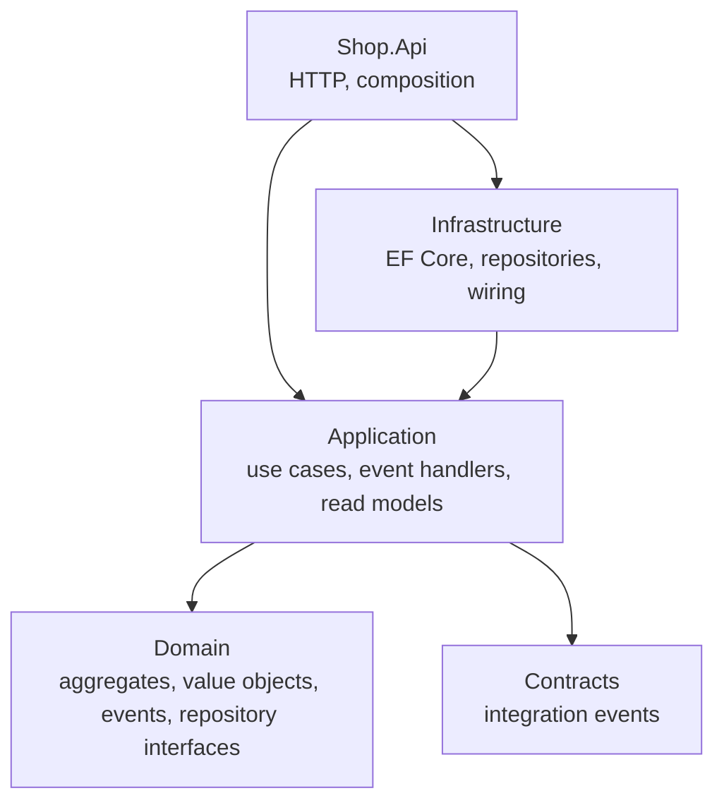

# Layer boundaries

Each bounded context is split into layers with one rule: **dependencies point inward, toward the
domain.**

## What goes where

| Layer | Contains | Must not contain | Sample |
|---|---|---|---|
| **Domain** | aggregates, entities, value objects, domain events, error codes, repository interfaces, domain services | EF Core, HTTP, logging, configuration, `DateTime.Now` | [Ordering.Domain](../src/Ordering/Ordering.Domain) |
| **Application** | one handler per use case, domain and integration event handlers, read model shapes, query interfaces | business rules, EF Core, HTTP | [Ordering.Application](../src/Ordering/Ordering.Application) |
| **Infrastructure** | DbContext, entity mappings, repository and query implementations, module registration | business rules | [Ordering.Infrastructure](../src/Ordering/Ordering.Infrastructure) |
| **Contracts** | integration events: public, versioned, primitives only | anything from the domain | [Ordering.Contracts](../src/Ordering/Ordering.Contracts) |
| **API / host** | endpoints, HTTP mapping of results and errors, composition of modules | business rules, data access | [Shop.Api](../src/Shop.Api) |

## A use case through the layers

`POST /orders/{id}/cancel`:

1. **API** — [Endpoints.cs](../src/Shop.Api/Endpoints.cs) turns the request into a `CancelOrder`
   command and calls the handler. It maps the `Result` to HTTP and does nothing else.
2. **Application** — `CancelOrderHandler` in
   [OrderCommands.cs](../src/Ordering/Ordering.Application/OrderCommands.cs) loads the order,
   calls `order.Cancel(reason, now)`, saves if it succeeded. It orchestrates; it does not decide.
3. **Domain** — `Order.Cancel` decides: already cancelled? shipped? Otherwise it changes state and
   raises `OrderCancelled`.
4. **Infrastructure** — saving dispatches the event, whose handler puts the integration event in the
   outbox, and commits.

If you find an `if` about business state in an endpoint or a handler, it belongs in the domain.

## Keeping the boundaries

Project references enforce the coarse rules: `Ordering.Domain` does not reference EF Core, so it
cannot use it. The rest is enforced by
[BoundaryTests.cs](../tests/Architecture.Tests/BoundaryTests.cs), which inspects the compiled
assemblies:

- the domain depends on nothing but the framework and `BuildingBlocks.Domain`;
- the application layer does not depend on EF Core, ASP.NET Core or any infrastructure;
- contracts depend on nothing but `BuildingBlocks.Contracts`;
- a context only depends on the *contracts* of another context;
- entities have no public setters.

These tests are cheap and catch erosion the moment it is introduced, in review rather than months
later.

## Pragmatic choices in this sample

- **Use case handlers are plain classes**, one per command, injected directly into endpoints. No
  mediator: the call is explicit and navigable. Add one if you want pipeline behaviours.
- **Commands are records with primitives.** Building value objects happens in the handler, so an
  invalid value throws `InvariantViolationException`, which the API maps to `400`.
- **Read models are built in infrastructure** but their shape (`OrderDetails`) is declared in the
  application layer, so the API depends on the shape and not on the database.
- **`BuildingBlocks` follows the same layering**: `BuildingBlocks.Domain` has no dependencies;
  `BuildingBlocks.Infrastructure` holds EF Core and hosting.
