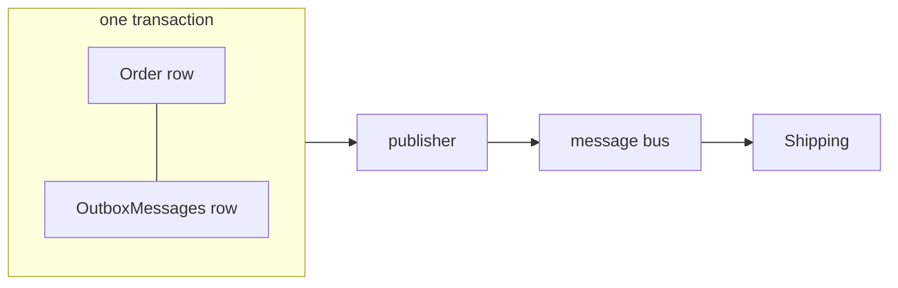

# The outbox pattern (and the inbox)

## The problem: dual writes

Placing an order must do two things: save the order, and tell Shipping. Done naively, these are two
writes to two systems, and one of them can fail:

| Order | Then | Result |
|---|---|---|
| save, then publish | publish fails, or the process crashes in between | order placed, nobody ships it |
| publish, then save | save fails (concurrency, constraint) | shipment for an order that does not exist |

No ordering of the two makes this safe, and distributed transactions across a database and a broker
are not available in practice.

## The solution: one local transaction, publish later

Write the outgoing message to an **outbox table in the same database, in the same transaction** as
the business change. A background publisher reads the table and publishes. Either both the order
and the message are stored, or neither is.



## How it works in the sample

1. A domain event handler calls `IOutbox.Enqueue(integrationEvent, messageGroup)`.
   [OutboxCollector.cs](../src/BuildingBlocks/BuildingBlocks.Infrastructure/Outbox/OutboxCollector.cs)
   serializes it and keeps it in memory.
2. `DbContextBase.SaveChangesAsync` drains the collector into the `{Context}OutboxMessages` table,
   then commits — one transaction. After the commit it signals the publisher.
3. [OutboxPublisherService.cs](../src/BuildingBlocks/BuildingBlocks.Infrastructure/Outbox/OutboxPublisherService.cs)
   wakes on the signal (or every polling interval) and runs
   [OutboxProcessor.cs](../src/BuildingBlocks/BuildingBlocks.Infrastructure/Outbox/OutboxProcessor.cs).
4. The processor publishes each message to `IMessageBus` and marks it published.

The outbox stores the **integration contract**, not the domain event. The domain model can be
refactored freely; what is in the table is already in its published form.

### Ordering: message groups

Consumers usually care about the order of events *for the same thing*: `order-placed` before
`order-cancelled` for one order. They rarely care about order across unrelated orders.

So every message has an optional **message group** (the sample uses `order-{id}` and
`shipment-{id}`):

- Within a group, messages are published in the order they were stored.
- If a message in a group fails, the rest of **that group** waits. Other groups continue.
- Messages without a group never wait for anything.

With a real broker, map the group to its ordering key: a session id (Azure Service Bus), a
partition key (Kafka, Event Hubs), a message group id (SQS FIFO).

### Retries: exponential backoff

A failed publish is recorded with `FailedAttempts`, `LastError` and `NextAttemptAt`. The next attempt
waits `RetryBaseDelay × 2^(attempt-1)`, capped at `RetryMaxDelay` (defaults: 2 s, capped at 5 min).
A broker outage therefore does not turn into a hot loop, and the message keeps its place in its
group.

### Cleanup

Published messages are deleted after `Retention` (default 7 days), so the table stays small.
Unpublished messages are never deleted. Keep an alert on the oldest unpublished message: it is the
best single health signal of the pattern.

### Options

Bind from configuration, see [appsettings.json](../src/Shop.Api/appsettings.json) and
[OutboxOptions.cs](../src/BuildingBlocks/BuildingBlocks.Infrastructure/Outbox/OutboxOptions.cs):
`BatchSize`, `PollingInterval`, `RetryBaseDelay`, `RetryMaxDelay`, `Retention`.

## Delivery is at least once

If the process crashes after publishing but before marking the message published, it is published
again on restart. This is unavoidable and by design. Consumers must therefore be **idempotent**.

## The inbox: idempotent consumers

[InMemoryMessageBus.cs](../src/BuildingBlocks/BuildingBlocks.Infrastructure/Messaging/InMemoryMessageBus.cs)
delivers every message through the inbox of the consuming context:

1. If `{Context}InboxMessages` has a row for (message id, handler), skip.
2. Otherwise add that row, run the handler, and save — **in one transaction** with the handler's
   own changes.

A redelivered message finds the row and is skipped. A handler that fails leaves no row, so the
retry runs it again. Register a handler with:

```csharp
services.AddIntegrationEventHandler<OrderPlacedIntegrationEvent, PrepareShipmentWhenOrderPlaced, ShippingDbContext>();
```

Making the handler itself naturally idempotent as well (Shipping checks whether a shipment for the
order already exists) is cheap extra safety. Prune old inbox rows on a schedule, keeping them longer
than the broker's maximum redelivery window.

## Exactly one publisher per outbox

Order within a group only holds if one publisher processes an outbox at a time. With a single
application instance, the hosted service guarantees that. With several instances (scale-out,
rolling deployments), guard each run with a distributed lock, for example:

- SQL Server: `sp_getapplock` with `@LockOwner = 'Session'` on a dedicated connection;
- PostgreSQL: `pg_try_advisory_lock`;
- a blob lease or a lease row with an expiry.

Take the lock at the start of a run in `OutboxPublisherService`; if it is held, skip the run.

## Replacing the in-memory bus

`IMessageBus` has one method. Implement it over your broker and register it before
`AddBuildingBlocks()` (which uses `TryAdd`):

```csharp
public sealed class ServiceBusMessageBus(ServiceBusSender sender) : IMessageBus
{
    public Task PublishAsync(MessageEnvelope envelope, CancellationToken cancellationToken) =>
        sender.SendMessageAsync(new ServiceBusMessage(envelope.Payload)
        {
            MessageId = envelope.MessageId.ToString(),   // enables broker-side duplicate detection
            Subject = envelope.Type,
            SessionId = envelope.MessageGroup,           // per-group ordering
        }, cancellationToken);
}
```

On the consuming side, a broker listener deserializes with `IntegrationEventTypes`, then calls the
registered `IIntegrationEventSubscription`s — the inbox logic stays the same.

## When you do not need it

If nothing outside the transaction has to learn about the change, there is no dual write and no
outbox. Domain events handled in-process within the same context need no outbox either; they share
the transaction already.
