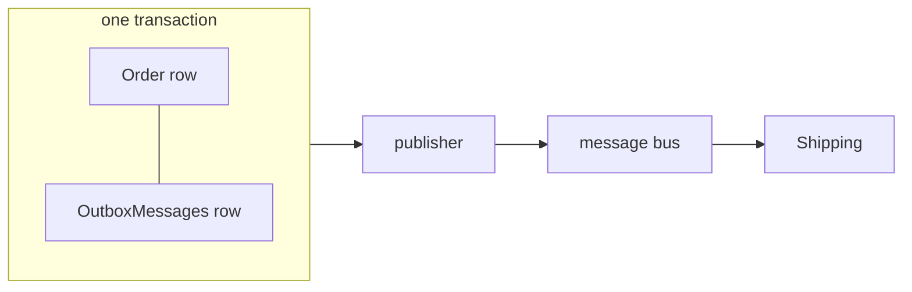

# The outbox pattern (and the inbox)

## The problem: dual writes

Placing an order must do two things: save the order, and tell Shipping. Done naively, these are two
writes to two systems, and one of them can fail:

| Order | Then | Result |
|---|---|---|
| save, then publish | publish fails, or the process crashes in between | order placed, nobody ships it |
| publish, then save | save fails (concurrency, constraint) | shipment for an order that does not exist |

No ordering of the two makes this safe, and distributed transactions across a database and a broker
are not available in practice.

## The solution: one local transaction, publish later

Write the outgoing message to an **outbox table in the same database, in the same transaction** as
the business change. A background publisher reads the table and publishes. Either both the order
and the message are stored, or neither is.



## How it works in the sample

1. A domain event handler calls `IOutbox.Enqueue(integrationEvent, messageGroup)`.
   [OutboxCollector.cs](../src/BuildingBlocks/BuildingBlocks.Infrastructure/Outbox/OutboxCollector.cs)
   serializes it and keeps it in memory.
2. `DbContextBase.SaveChangesAsync` drains the collector into the `{Context}OutboxMessages` table,
   then commits — one transaction. After the commit it signals the publisher.
3. [OutboxPublisherService.cs](../src/BuildingBlocks/BuildingBlocks.Infrastructure/Outbox/OutboxPublisherService.cs)
   wakes on the signal (or every polling interval) and runs
   [OutboxProcessor.cs](../src/BuildingBlocks/BuildingBlocks.Infrastructure/Outbox/OutboxProcessor.cs).
4. The processor publishes each message to `IMessageBus` and marks it published.

The outbox stores the **integration contract**, not the domain event. The domain model can be
refactored freely; what is in the table is already in its published form.

### Ordering: message groups

Consumers usually care about the order of events *for the same thing*: `order-placed` before
`order-cancelled` for one order. They rarely care about order across unrelated orders.

So every message has an optional **message group** (the sample uses `order-{id}` and
`shipment-{id}`):

- Within a group, messages are published in the order they were stored.
- If a message in a group fails, the rest of **that group** waits. Other groups continue.
- Messages without a group never wait for anything.

With a real broker, map the group to its ordering key: a session id (Azure Service Bus), a
partition key (Kafka, Event Hubs), a message group id (SQS FIFO).

### Fairness: failures must not starve the rest

A naive fetch takes the `BatchSize` oldest unpublished messages and skips the ones that are backing
off *in memory*. The day `BatchSize` messages are backing off at once, every run reads the same
failed batch and nothing else is ever published: one broken group stops the whole outbox.

So the fetch filters in the database, before `TAKE`:

- skip messages whose `NextAttemptAt` lies in the future;
- skip messages queued behind a backed-off message of the same group (an earlier `Id`).

```csharp
.Where(m => m.PublishedAt == null && (m.NextAttemptAt == null || m.NextAttemptAt <= now))
.Where(m => m.MessageGroup == null || !messages.Any(blocking =>
    blocking.MessageGroup == m.MessageGroup && blocking.PublishedAt == null
    && blocking.NextAttemptAt > now && blocking.Id < m.Id))
.OrderBy(m => m.Id)
.Take(batchSize)
```

Written by hand in SQL, collect the blocked groups first (into a temp table or table variable) and
join on that. A common table expression looks equivalent but can be re-evaluated per candidate row,
which makes the fetch quadratic in the size of the backlog: exactly when the backlog is large.

The test `Messages_in_backoff_never_starve_the_messages_behind_them` fills a batch with failures and
proves the healthy message behind it still goes out without any time passing.

### Retries: exponential backoff

A failed publish is recorded with `FailedAttempts`, `LastError` and `NextAttemptAt`. The next attempt
waits `RetryBaseDelay × 2^(attempt-1)`, capped at `RetryMaxDelay` (defaults: 2 s, capped at 5 min).
A broker outage therefore does not turn into a hot loop, and the message keeps its place in its
group.

### Transient and permanent failures

Not every failure goes away by waiting. A message whose `Type` no longer maps to a contract (it was
renamed or removed), or whose payload no longer fits the contract, fails on every attempt until
someone deploys a fix or repairs the data. The processor checks the type before publishing and
raises `UnresolvableMessageException` for it; `IntegrationEventTypes.Deserialize` raises the same
for a payload it cannot read.

The sample still retries such a message with backoff (a deployment may fix it, and its group must
keep waiting to preserve order), but it logs it as an **error** and counts it with
`reason=unresolvable`. That makes it visible as what it is: something a person has to act on, not
something that will heal itself. Alert on any occurrence.

### Indexes follow the queries

The outbox is read by three queries, each with its own index in
[DbContextBase.cs](../src/BuildingBlocks/BuildingBlocks.Infrastructure/Persistence/DbContextBase.cs):

| Query | Index |
|---|---|
| fetch pending messages in `Id` order | filtered on `PublishedAt IS NULL`, on `Id` |
| probe a group for a blocked earlier message | filtered on `PublishedAt IS NULL`, on `(MessageGroup, Id)` |
| delete published messages older than the retention | on `PublishedAt` |

The filtered indexes stay small however large the table grows, because published rows drop out of
them. Do not trust a plan on a table with a hundred rows: check the indexes against a copy with a
production-sized backlog and history, and revisit them whenever a query changes.

### Cleanup

Published messages are deleted after `Retention` (default 7 days), so the table stays small.
Unpublished messages are never deleted. Keep an alert on the oldest unpublished message: it is the
best single health signal of the pattern (see [Operating the outbox](#operating-the-outbox)).

### Options

Bind from configuration, see [appsettings.json](../src/Shop.Api/appsettings.json) and
[OutboxOptions.cs](../src/BuildingBlocks/BuildingBlocks.Infrastructure/Outbox/OutboxOptions.cs):
`BatchSize`, `PollingInterval`, `RetryBaseDelay`, `RetryMaxDelay`, `Retention`.

## Delivery is at least once

If the process crashes after publishing but before marking the message published, it is published
again on restart. This is unavoidable and by design. Consumers must therefore be **idempotent**.

### Published, but not recorded

The same happens without a crash: the broker accepts the message, then the `SaveChanges` that marks
it published fails, usually because the database is unavailable. Two tempting reactions are both
wrong:

- **Marking the message as failed.** Nothing is wrong with the message; it would start a backoff and
  hold back its group for a problem it does not have. The save would most likely fail as well.
- **Carrying on with the next message.** Every message published in that run would be published
  again on the next one, because none of them can be recorded.

The processor throws `OutboxPublicationNotRecordedException`, which ends the run, and counts it with
`reason=not_recorded`. The message stays unpublished without a failed attempt, is published again
when the database is back, and the inbox absorbs the duplicate.

## The inbox: idempotent consumers

[InMemoryMessageBus.cs](../src/BuildingBlocks/BuildingBlocks.Infrastructure/Messaging/InMemoryMessageBus.cs)
delivers every message through the inbox of the consuming context:

1. If `{Context}InboxMessages` has a row for (message id, handler), skip.
2. Otherwise add that row, run the handler, and save — **in one transaction** with the handler's
   own changes.

A redelivered message finds the row and is skipped. A handler that fails leaves no row, so the
retry runs it again. Register a handler with:

```csharp
services.AddIntegrationEventHandler<OrderPlacedIntegrationEvent, PrepareShipmentWhenOrderPlaced, ShippingDbContext>();
```

Making the handler itself naturally idempotent as well (Shipping checks whether a shipment for the
order already exists) is cheap extra safety. Prune old inbox rows on a schedule, keeping them longer
than the broker's maximum redelivery window.

## Exactly one publisher per outbox

Order within a group only holds if one publisher processes an outbox at a time. With a single
application instance, the hosted service guarantees that. With several instances (scale-out,
rolling deployments), guard each run with a distributed lock, for example:

- SQL Server: `sp_getapplock` with `@LockOwner = 'Session'` on a dedicated connection;
- PostgreSQL: `pg_try_advisory_lock`;
- a blob lease or a lease row with an expiry.

Take the lock at the start of a run in `OutboxPublisherService`; if it is held, skip the run.

Pick the lock that needs no new infrastructure: when the outbox lives in SQL Server, an application
lock named after the outbox costs nothing extra. Cleanup must run under the same lock, or delete with
a hint that skips locked rows (`READPAST` on SQL Server, `SKIP LOCKED` on PostgreSQL), so it never
blocks the publisher.

## Replacing the in-memory bus

`IMessageBus` has one method. Implement it over your broker and register it before
`AddBuildingBlocks()` (which uses `TryAdd`):

```csharp
public sealed class ServiceBusMessageBus(ServiceBusSender sender) : IMessageBus
{
    public Task PublishAsync(MessageEnvelope envelope, CancellationToken cancellationToken) =>
        sender.SendMessageAsync(new ServiceBusMessage(envelope.Payload)
        {
            MessageId = envelope.MessageId.ToString(),   // enables broker-side duplicate detection
            Subject = envelope.Type,
            SessionId = envelope.MessageGroup,           // per-group ordering
        }, cancellationToken);
}
```

On the consuming side, a broker listener deserializes with `IntegrationEventTypes`, then calls the
registered `IIntegrationEventSubscription`s — the inbox logic stays the same.

## Operating the outbox

An outbox fails silently: the business transaction commits, the user sees success, and the message
just sits there. Measure it.
[OutboxMetrics.cs](../src/BuildingBlocks/BuildingBlocks.Infrastructure/Outbox/OutboxMetrics.cs)
publishes, under the meter `BuildingBlocks.Outbox`:

| Instrument | Kind | Use it for |
|---|---|---|
| `outbox.pending.count` | gauge, per context | the size of the backlog |
| `outbox.pending.oldest_age` | gauge, per context | **the** alert: how long the oldest message has waited |
| `outbox.messages.failed` | counter, by `reason` | `transient` (broker trouble), `unresolvable` (needs a person), `not_recorded` (database trouble) |
| `outbox.messages.published` | counter, per context | throughput |
| `outbox.publish.latency` | histogram, per event type | time from enqueue to publication |

Export them with OpenTelemetry (`AddMeter(OutboxMetrics.MeterName)`). Two alerts cover most
incidents:

- the oldest pending message is older than a threshold that fits your business (15 minutes is a
  reasonable start);
- any `unresolvable` failure.

The sample refreshes the backlog gauges after each publication run and computes the age when it is
observed, so it keeps growing when runs stop. In production, also measure the backlog **from the
database**, with a small scheduled job or a log query. An alert that is fed by the publisher is
silent exactly when the publisher is dead.

### Load testing

Measure latency as *published at* minus *enqueued at*, per event type, under a realistic load. What
to look for:

- **A sawtooth is normal.** With polling, a message waits up to one interval; with the commit signal
  most messages go out almost immediately.
- **Latency must not grow over the run.** A rising line means the publisher cannot keep up and a
  backlog is forming.
- **Separate queueing from publishing.** When a whole batch waits several seconds and then goes out
  within a few hundred milliseconds, the publisher is fine and the delay sits upstream: the
  transaction that enqueued the messages, a lock, or the trigger of the run.

## Removing an event or a handler

Messages that are already in the outbox, or in the broker, still carry the old type. Remove in two
steps:

1. Stop enqueueing the event (or stop subscribing the handler) and deploy.
2. Remove the contract or the handler only after the outbox has drained **and** after the period in
   which a database restore could bring old messages back. That period is set by your backup
   retention and disaster recovery plan, and is usually weeks rather than days.

Removing it in one step turns every remaining message into an unresolvable one.

## An alternative design: store the domain event and its handler

This sample stores the *integration contract*. Another design stores the *domain event* plus the
name of the handler that should process it, one record per out-of-process handler. A worker later
deserializes the event and runs that handler in its own scope, with its own retry and a trace linked
to the original request.

That buys flexibility: the deferred side effect need not be a message on a bus. It can write a
blob, call a webhook or update another store, each reliably and each retried on its own. The price:

- **The domain event becomes a stored contract.** Changing its shape can break records already in
  the table. Keep a repair hook per handler that receives the unreadable record and returns a fixed
  event, or nothing to skip it deliberately.
- **Round-trip tests for every stored event are mandatory**, not nice to have.
- More records per business change, and handler names (types) in your data.

Choose it when most deferred work is not publishing; otherwise the contract-based outbox is simpler.

## Governance

The outbox and inbox tables hold technical data: transient, with a payload whose structure varies
per row. Exclude them from your data dictionary and data classification tooling, and say why in the
tooling's configuration, so nobody has to rediscover it. Do apply the retention: payloads may still
contain personal data.

## When you do not need it

If nothing outside the transaction has to learn about the change, there is no dual write and no
outbox. Domain events handled in-process within the same context need no outbox either; they share
the transaction already.
